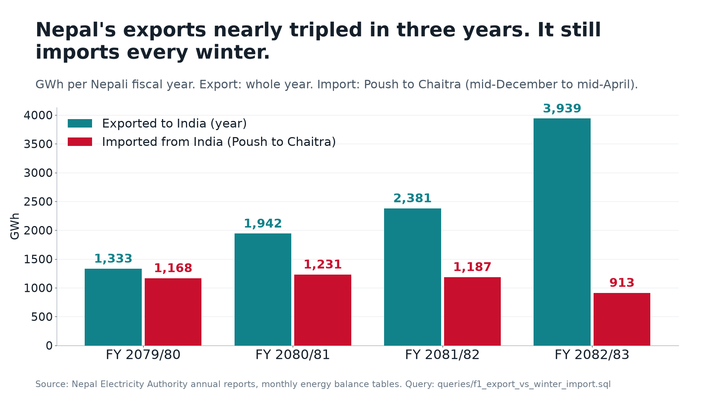
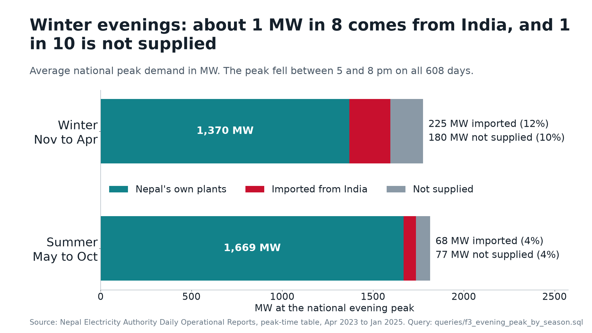
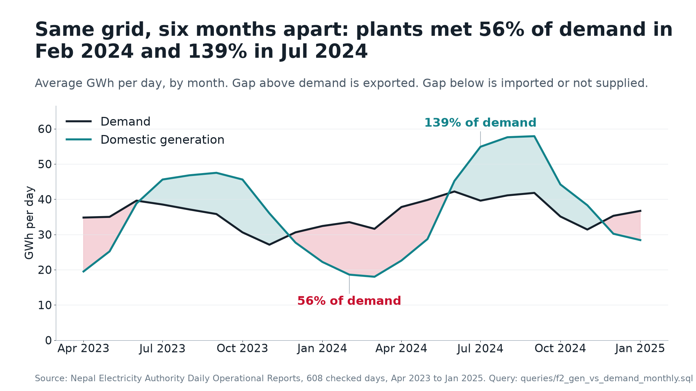

# Nepal's winter electricity gap, in open data

Nepal's grid runs almost entirely on hydropower, and most plants are run-of-river. In the monsoon the rivers are full and Nepal sells power to India. From December to April the rivers drop, and Nepal buys power back. The shortfall is sharpest at the evening peak. The numbers needed to plan around this gap are public, but they sit in PDFs, image-only tables, two calendars and a fiscal year that starts in mid-July. This project collects them into one queryable database, checks them, and shows the gap.

**Live site:** [nea-winter-outlook.pages.dev](https://nea-winter-outlook.pages.dev): charts, a map of every data point, and a SQL console that runs in your browser.



## Findings

Each number below comes from a query in [`queries/`](queries/). `uv run nea findings` re-runs them all into [`assets/findings.json`](assets/findings.json) and redraws the charts.

1. **Nepal now exports far more than before, and still imports every winter.** In FY 2082/83 Nepal exported 3,939 GWh to India. Between Poush and Chaitra (mid-December to mid-April) it still imported 913 GWh. Three years earlier the figures were 1,333 and 1,168 GWh. Exports nearly tripled, while winter imports fell by about a fifth. The surplus and the shortage are six months apart. Query: [`f1_export_vs_winter_import.sql`](queries/f1_export_vs_winter_import.sql)
2. **The same grid swings from 56% to 139% of demand.** In February 2024 Nepal's own plants produced 56% of the energy the country needed. In July 2024 they produced 139%. Query: [`f2_gen_vs_demand_monthly.sql`](queries/f2_gen_vs_demand_monthly.sql)
3. **The shortage is sharpest at the evening peak.** On an average winter day (Nov to Apr), 225 MW of the 1,775 MW evening peak came from India (12%), and another 180 MW (10%) was not supplied. In summer both shares were about 4%. The national peak fell between 5 and 8 pm on all 608 days. Queries: [`f3_evening_peak_by_season.sql`](queries/f3_evening_peak_by_season.sql), [`f4_peak_hour.sql`](queries/f4_peak_hour.sql)





A forecast of the coming winter (demand, river flow, imports, with ranges) is on the [live site](https://nea-winter-outlook.pages.dev/forecast). The method and its backtests are in [`docs/models/`](docs/models/).

## Data sources

| Source | What it gives | Link |
|---|---|---|
| NEA Daily Operational Reports | Daily energy balance and evening-peak table, Apr 2023 to Jan 2025 (NEA stopped publishing after that) | [transd.nea.org.np](https://transd.nea.org.np/en/category/daily-operational-reports-1) |
| NEA annual reports | Monthly energy and capacity balance per fiscal year, annual history since 2013 | [nea.org.np](https://nea.org.np/en/category/annual-reports) |
| NEA homepage | Daily figures from 25 Oct 2026, collected going forward | [nea.org.np](https://nea.org.np/) |
| India customs (TradeStat) | Monthly electricity trade with Nepal since 2016 | [tradestat.commerce.gov.in](https://tradestat.commerce.gov.in/meidb/commodity_wise_all_countries_import) |
| CERC market monitoring | Nepal's trades on India's power exchange | [cercind.gov.in](https://www.cercind.gov.in/report_MM-2026.html) |
| ERA5 weather, GloFAS river flow (via Open-Meteo) | Daily temperature and river discharge since 2010, plus a 7-month river forecast | [open-meteo.com](https://open-meteo.com/) |
| World Bank | GDP and population | [data.worldbank.org](https://data.worldbank.org/country/nepal) |

Full list, with status and notes: [`docs/data-sources.md`](docs/data-sources.md).

## Reproduce

```bash
uv sync && uv run playwright install chromium
uv run nea ingest all     # first run downloads every source (PDFs, reports, APIs). Later runs fetch only what is new.
uv run nea findings       # queries/*.sql -> assets/findings.json + the three charts
```

Every command writes a time-stamped log to `data/logs/`. NEA's sites block some foreign traffic, so the scrapers are meant to run from Nepal. `uv run pytest` runs the offline tests.

To query the data yourself: `uv run nea sql "FROM gold.daily_features LIMIT 5"`, or the SQL console on the live site. Every table is described in [`docs/lake.md`](docs/lake.md).

## Data and provenance

- Raw downloads are kept unchanged in `data/raw/` (PDF, JSON, Markdown), and every fetch is logged with its URL and status in `bronze.ingest_log`. Every table can be rebuilt from the raw files.
- **What I had to clean, and why:**
  - **The daily series is short.** NEA posted 639 daily reports. 6 had no PDF attached. The other 633 cover 612 distinct days, because some reports were re-issued for the same day (the later one is kept). 4 days with all-zero figures fail the energy-balance check. That leaves 608 days.
  - **Some balance tables are images.** The monthly balance tables in NEA annual reports are images. They were read with OCR and cross-checked against tables extracted as text.
  - **Calendars.** NEA reports use the Nepali calendar (Bikram Sambat), and fiscal years start in Shrawan (mid-July). Each BS month was mapped to dates through a calendar table. "Winter" in the daily data means November to April.
  - **Sources disagree.** For FY 2082/83, imports are 954 GWh in India's customs data, 1,122 GWh in NEA's monthly balance and 1,171 GWh in NEA's annual table. This repo quotes NEA's figures and keeps the others for comparison.
  - **An incomplete year.** FY 2078/79 is missing one winter month (Falgun) in the parsed balance table, so finding 1 starts at FY 2079/80.

## Known limitations

- Daily data covers only two winters, because NEA stopped publishing daily reports in January 2025.
- **Not supplied** above is the NDOR "Interruption" and "Deficit" at peak. I have not found NEA's written definition of how interruptions are counted.
- No data on spilled energy (water that bypasses turbines in the monsoon) is in any table parsed so far.
- River flow comes from a global model (GloFAS), not from Nepal's river gauges. The DHM gauge site has been offline since October 2026, and a data request has been sent.
- The forecast's flood adjustment uses plant losses reported in the news and a rule-of-thumb output factor. Treat it as a scenario.

## Next steps

- Keep collecting NEA's daily homepage figures through this winter, and score the forecast against them each week.
- Request DHM gauge data for the main hydro rivers, to replace modelled river flow where possible.
- Look for spilled-energy figures in NEA's reports and add them if they exist.

## Repository layout

| Path | What |
|---|---|
| `queries/` | The SQL behind every headline number |
| `assets/` | Charts (1920x1080) and `findings.json` |
| `src/nea_forecast/` | Ingesters, lakehouse, analysis, models, CLI (`nea …`) |
| `site/` | The website (Observable Framework + DuckDB-WASM + Leaflet), deployed to Cloudflare Pages: [`docs/site.md`](docs/site.md), [`docs/deploy.md`](docs/deploy.md) |
| `sources.json`, `outages.json` | Source registry, and capacity out of service with news sources |
| `docs/architecture.md` | Diagrams of the whole system |
| `docs/flow.md` | Every command and source, incremental rules, schedule |
| `docs/lake.md` | Every table and how to query it |
| `docs/eda-findings.md`, `docs/models/`, `docs/model-results.md` | Analysis, model write-ups, backtest results |
| `docs/developer/decisions.md` | Decisions and change log |

## Credits

- Inspired by [nea-data-warehouse](https://github.com/Unknown-333/nea-data-warehouse) by **Aayush Paudel** ([@Unknown-333](https://github.com/Unknown-333)): the NDOR URL pattern, report field list, and energy-balance check idea. Re-implemented here, no code copied.
- Data: Nepal Electricity Authority, Department of Hydrology and Meteorology Nepal, [Open-Meteo](https://open-meteo.com/) (CC BY 4.0), Copernicus GloFAS, ECMWF ERA5, World Bank, India Ministry of Commerce (TradeStat), CERC.

Educational, non-commercial project by Amrit Phuyal, Kathmandu.

## License

Code: [MIT](LICENSE). The data belongs to its publishers and keeps their terms (see Data sources and Credits). One dependency has a stronger licence: `pymupdf4llm` / PyMuPDF (AGPL), used to turn report PDFs into Markdown. Review ADR-002 in [`docs/developer/decisions.md`](docs/developer/decisions.md) before redistributing a closed build.
