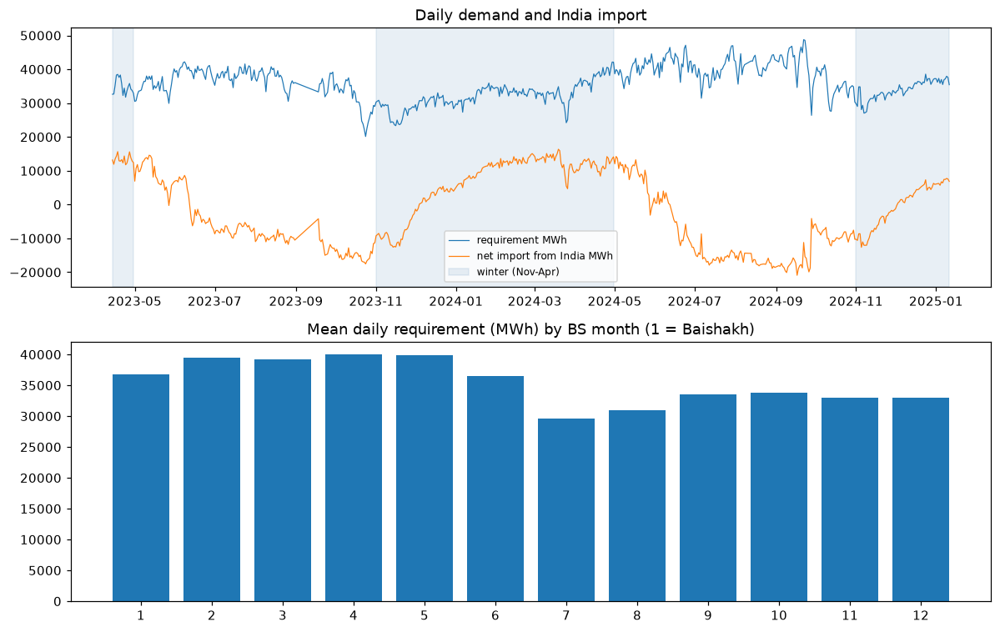
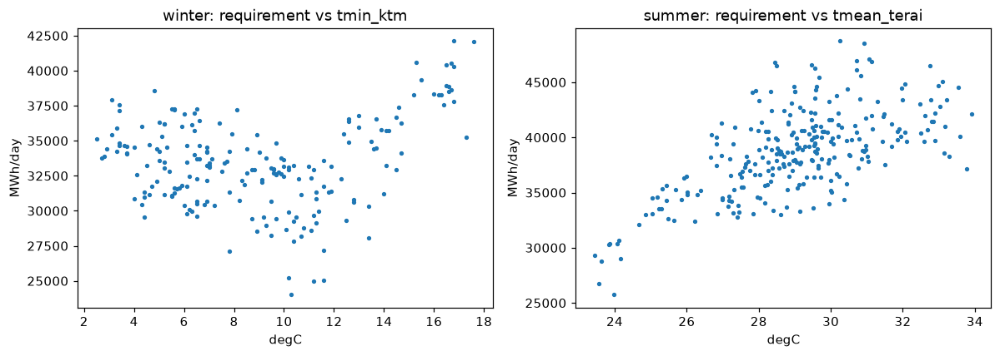
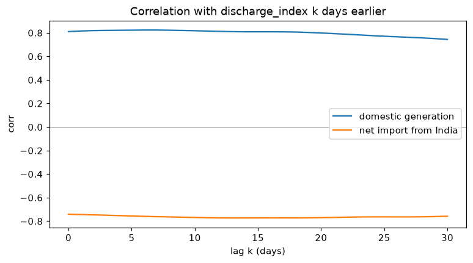
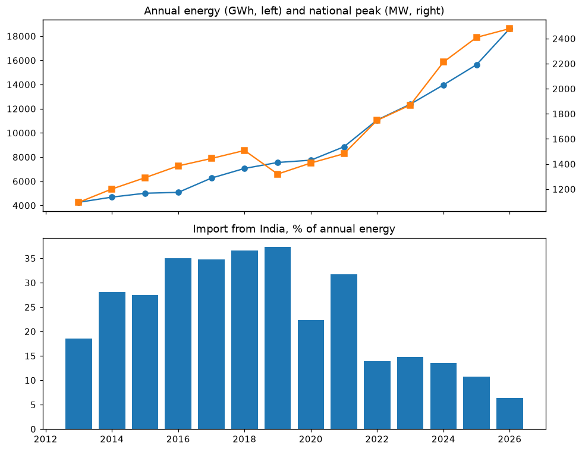
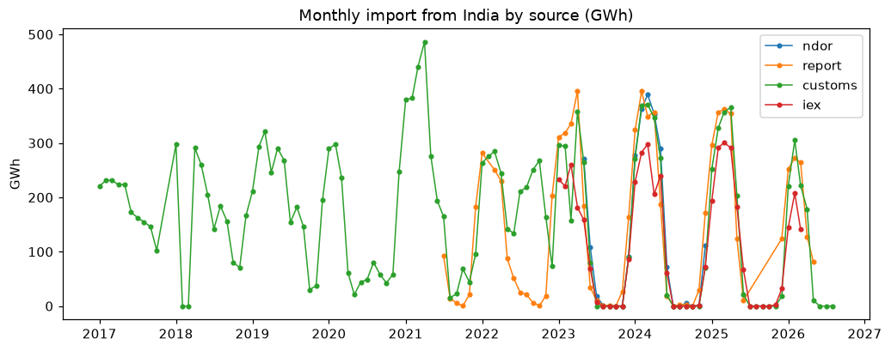
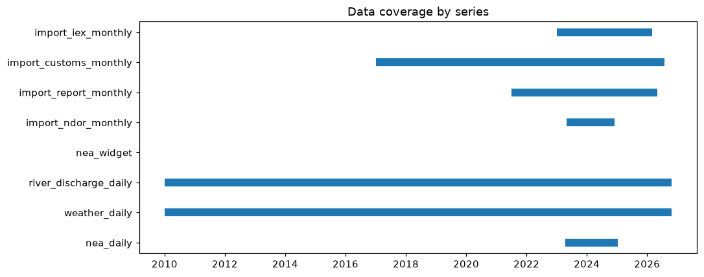

# EDA findings (Phase 2)

Source: `uv run nea eda` on 2026-10-25 → [`eda/summary.json`](eda/summary.json) + charts in [`eda/`](eda/). Log: `data/logs/*-eda.log`. Daily stats use NDOR `qa_ok` days (612, 2023-04-14 → 2025-01-11).

## 1. Seasonality

- Saturday (weekend) ≈ 34.3 GWh/day vs ≈ 36.0 on other days: **−5%**. Holidays (vs non-holidays of the same BS month, 18 months): **−5.1%**.
- Monsoon/summer demand is **higher** than winter (38.1 vs 32.8 GWh/day; peaks 1,814 vs 1,775 MW), but in summer Nepal **exports** (net −7.0 GWh/day) and in winter **imports** (+5.3 GWh/day). The import problem is a supply problem (dry rivers), not a demand spike.
- BS month profile: low in Kartik–Poush (7–9, ~30–33.5 GWh/day), high in Jestha–Bhadra (2–5, ~39.5–40 GWh/day).

## 2. Temperature

- Summer: Terai mean temperature drives demand (corr **0.64**, **+1,170 MWh/day per °C**): cooling load.
- Winter (Nov–Apr) as a whole: corr +0.21, because April heat pushes demand up. Core winter Dec–Feb, working days: corr **−0.24**, −315 MWh/day per °C (n = 104): a weak heating effect.

## 3. River discharge

- Domestic generation follows `discharge_index` (corr **0.82**); India import moves opposite (**−0.77**). n = 608.
- The lag curve is flat (0.81 at lag 0, 0.74 at 30 days): the shared seasonal cycle dominates, so the "best lag" (gen 6 d, import 13 d; basins 4–7 d) is weak evidence. Use same-day flow plus a 7-day mean.

## 4. Long-term growth

- 2013 → 2026 (14 years): energy **+12.0%/yr**, national peak **+6.5%/yr**.
- GDP elasticity of energy **2.6** (log-log, R² 0.96, n = 13).
- Import share of annual energy: 35–37% (2016–2019) → **6% in 2026**, as new domestic hydro came online.

## 5. Import sources

| vs | n months | ratio | corr | WAPE |
|---|---|---|---|---|
| customs vs NDOR (both AD months) | 19 | 0.92 | **0.99** | **8.9%** |
| NDOR vs NEA report | 19 | 1.04 | 0.95 | 28% |
| customs vs NEA report | 53 | 1.09 | 0.81 | 39% |
| IEX purchase vs NEA report | 34 | 0.74 | 0.93 | 34% |

The NEA report is in BS months (start mid-AD-month), so its error vs AD-month sources is mostly the half-month shift. The match between customs and NDOR (0.99) shows customs is a good monthly import proxy. IEX is only the exchange part (~74%) of the import; the rest is bilateral/PPA.

## 6. Gaps

- NDOR: 27 missing days, longest **17 days** (2023-09-01 → 09-17); NEA publishes nothing daily after 2025-01-11. Widget snapshots only from 2026-10-25.
- Weather and discharge: complete 2010 → today.
- Monthly import: customs 2017-01 → 2026-08 (114/116), NEA report 2021-07 → 2026-05 (53/59), IEX 2023-01 → 2026-03 (39/39). Annual: 2013–2026 complete.

## Phase 3 inputs (decisions)
Rule: keep a feature if |corr| ≥ 0.3 or effect ≥ 5%.

1. **Daily model** (targets `requirement_mwh`, `peak_demand_mw`, `net_exchange_india_mwh`; NDOR period only): keep weekday/Saturday, holiday, `tmean_terai`, `discharge_index` (same day + 7-day mean). `tmin_ktm` is under the bar (0.24): let LightGBM test it, but leave it out of the statistical models. Two winters only → forecasts 7–30 days ahead, backtested on winter 2024/25.
2. **Monthly winter outlook:** demand = NEA report monthly balance (53 months ≥ 48 → enough), trended by the 12%/yr growth / GDP elasticity. Import = customs monthly (2017 →, latest), scaled ÷1.09 to the NEA report level (customs reads 9% higher).
3. **Import need:** generation tracks discharge (0.82 ≥ 0.6) → model it as demand − domestic generation (generation from discharge), and also model import directly; compare both in the backtest.
4. **Added after the EDA (2026-10-26):** the Aug 2026 flood (~480 MW lost) is outside all history, so it is handled by an outage register ([models/outages.md](models/outages.md)), and the GloFAS river-flow forecast replaces persistence in live runs ([models/river-forecast.md](models/river-forecast.md)).
5. **Still missing:** daily data after Jan 2025 (NEA request), DHM gauge data (email sent), Kulekhani level (no source).
