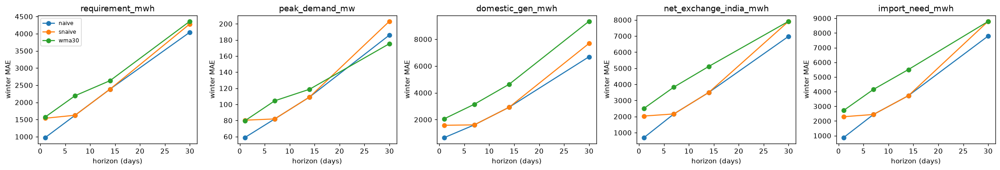
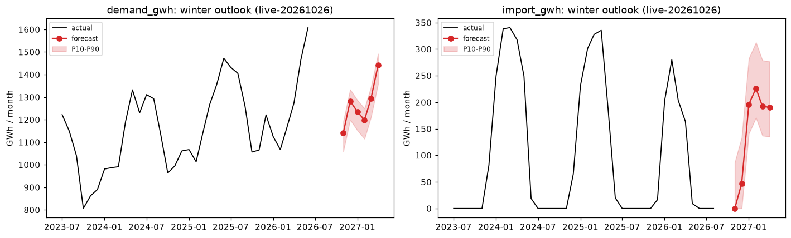

# Model results (Phase 3)

Run on 2026-10-26: `uv run nea model` (backtest, ~75 s) and `uv run nea forecast` (live). Approach and defence: [models/README.md](models/README.md). Every number is in the lake: `ml.backtest_metrics` and `ml.forecasts`. Logs: `data/logs/*-model.log` and `*-forecast.log`.

## What ships

| Forecast | Model used | Winter error (test winter 2024/25) | Doc |
|---|---|---|---|
| Daily demand (energy), 1–30 d | ridge | 2.5% (1 d) → 4.9% (30 d) MAPE; baseline 3.0% → 12.5% | [ridge](models/ridge.md) |
| Daily peak MW, 1–30 d | ridge | 2.4% (1 d) → 4.0% (30 d); baseline 3.3% → 9.6% | [ridge](models/ridge.md) |
| Daily domestic generation | naive at 1–14 d, ridge at 30 d | 2.0% → 8.8% | [baselines](models/baselines.md), [ridge](models/ridge.md) |
| Daily import need | demand forecast − generation forecast | MAE 0.9 → 3.8 GWh/day | [import-need](models/import-need.md) |
| Monthly winter demand (Nov–Apr) | combo (seasonal naive × growth, log-linear, ETS) | 3.0–6.5% per month | [monthly-outlook](models/monthly-outlook.md) |
| Monthly winter import | combo | MAE 5–93 GWh/month (import runs 0–340) | [monthly-outlook](models/monthly-outlook.md) |
| Ranges | P10/P90 from recent out-of-sample errors | coverage 80–97% (target 80%); 58–67% for 30-day import | [intervals](models/intervals.md) |

Selection rule: climb from the best baseline only when the winter error is > 5% lower and the Diebold–Mariano p < 0.10, then take the simplest model within 5% of the winner. Full list: [model/selection.json](model/selection.json).

**LightGBM** was tested on every target and horizon. It is significantly worse than ridge on demand and peak (2–3× the error at 14–30 days). It "won" only as the direct import-need model at 30 days, and import need ships via the difference method, so no live forecast uses it. It stays in the backtest as the challenger, so each new winter re-tests it.

## Daily backtest

Winter MAE by horizon, ex-ante (climatology weather). Ridge sits below every baseline for demand and peak; generation and import are harder (river flow).

## Monthly backtest

Two hold-out winters, origin 31 October, using only data published by then (NEA report to June, customs to August).

## Live winter outlook 2026/27 (run `live-20261026`)

| Month | Demand GWh (P10–P90) | Import GWh (P10–P90) |
|---|---|---|
| Nov 2026 | 1,141 (1,058–1,192) | 0 (0–86) |
| Dec 2026 | 1,282 (1,199–1,333) | 47 (0–133) |
| Jan 2027 | 1,236 (1,153–1,287) | 196 (141–282) |
| Feb 2027 | 1,198 (1,115–1,249) | 226 (171–313) |
| Mar 2027 | 1,293 (1,210–1,344) | 192 (137–279) |
| Apr 2027 | 1,441 (1,358–1,492) | 190 (135–277) |

- Winter demand total: 7,591 GWh. The GDP cross-check (last winter × (1 + 2.6 × 3.4% GDP growth)) gives 7,519 GWh, a gap of +1.0%.
- Import ranges come from only 12 hold-out residuals, so treat them as indicative.

**Daily live forecasts** start once the NEA widget has 8 consecutive days. Run `nea ingest widget` daily. A dry run on 2025-01-05 data produced all 16 daily rows in about 1 s.

## Limits (say them first)

- **One test winter for daily models** (Nov 2024 – Jan 2025). The 30-day demand error moves 4.9–7.6% under ±3 °C threshold changes, so quote it as 5–8%.
- **Ranges** are too wide for demand (cautious) and too narrow for 30-day import. The fix (same-season windows) waits for a second winter of out-of-sample errors.
- **Import depends on river flow:** with actual discharge, the 30-day generation error drops from 8.8% to 5.4%. Adding the GloFAS river-flow **forecast** is the biggest available improvement.
- **Not modelled:** India-side supply limits and prices, and new plant commissioning dates.
- **Live daily data depends on the NEA homepage widget,** which has only a short history and the risk that its layout changes.
