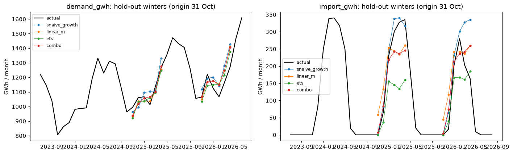

# Monthly winter outlook (Nov–Apr)

**Role:** before winter starts (origin = end of October), forecast each month's demand and import for Nov–Apr.

## Data

- **Demand:** NEA annual-report monthly balance, national demand GWh, 2021-07 → 2026-05 (53 months; BS months mapped to the AD month they start in).
- **Import:** customs monthly 2017 → (÷1.09: customs reads 9% above NEA); also the NEA report import.
- **Driver:** monthly mean `discharge_index` (anomaly vs climatology). In the backtest the future anomaly is the last observed month (persistence). In live runs it is the GloFAS seasonal forecast ([river-forecast](river-forecast.md)).
- **Flood losses:** the live import forecast is also shown as `combo+outage`, adding capacity lost in the Aug 2026 flood ([outages](outages.md)).

**What's known at the origin (31 October).**
- NEA annual-report figures cover the fiscal year to Ashadh, which lands in the June AD month.
- Customs lags about 2 months, so it reaches August.

The backtest uses only data published by then, so the forecasts run 5–10 months past the last NEA demand figure.

## Models

| Name | Forecast | Why |
|---|---|---|
| `snaive_growth` | same month last year × (1 + trailing 12-month growth) | captures seasonality and the 12%/yr growth in one line; strong in short monthly series |
| `linear_m` | $\log y = a + b\,\text{trend} + \text{month dummies} + c\,\text{discharge anomaly}$ | log keeps growth multiplicative; the discharge term lets a dry year raise import |
| `ets` | statsmodels Holt-Winters (gaps filled by linear interpolation) on $\log y$: damped additive trend, additive 12-month season | the standard monthly benchmark [lit 33]; damping stops over-extrapolating growth |
| `combo` | equal-weight mean of the three | combinations beat single methods in M4 [lit 26] |

**Annual cross-check.** The sum of the Nov–Apr forecast is compared with the annual path implied by GDP elasticity (2.6, EDA) and the IMF/World Bank GDP outlook. A gap of more than 10% is flagged in the results. This matches local practice: NEA's long-term forecasts use GDP elasticity [lit 7].

## Testing

- Hold-out winters 2024/25 and 2025/26: train strictly before each 1 November and forecast 1–6 months ahead.
- Metrics: MAPE for demand, MAE for import, per month-ahead.
- Unit test: a series growing exactly 10%/yr with a fixed season → `snaive_growth` MAPE 0.

## Limits

- 53 months is about 4.4 seasonal cycles: enough for ETS seasonality, but the intervals are wide.
- Two hold-out winters means "best model" is weakly established. `combo` is the default unless one model wins both winters.
- New large plants (commissioning dates) aren't modelled, so import forecasts can be too high in the winter a big plant comes online. Lost plants are handled by the outage register ([outages](outages.md)).

## Results

Run `bt-20261026-083658`. Hold-out winters 2024/25 and 2025/26, origin 31 Oct. MAE in GWh per month (MAPE), by months ahead.

| Target | Model | Nov | Dec | Jan | Feb | Mar | Apr |
|---|---|---|---|---|---|---|---|
| demand | snaive_growth | 43 (4.2%) | 47 (4.2%) | 52 (4.7%) | 81 (7.9%) | 72 (6.2%) | 109 (8.6%) |
| | linear_m | 38 (3.8%) | 39 (3.4%) | 41 (3.7%) | **56 (5.3%)** | 59 (5.1%) | 76 (5.9%) |
| | ets | 53 (5.2%) | 53 (4.5%) | **27 (2.5%)** | 66 (6.3%) | **46 (4.0%)** | **62 (4.9%)** |
| | **combo** (used) | **29 (3.0%)** | 46 (4.0%) | 30 (2.7%) | 68 (6.5%) | 59 (5.1%) | 71 (5.5%) |
| import | snaive_growth | **0** | 32 | 23 | **29** | 69 | 95 |
| | linear_m | 51 | 84 | 30 | 48 | **63** | **85** |
| | ets | **0** | **26** | 56 | 134 | 118 | 99 |
| | **combo** (used) | 5 | 38 | **11** | 51 | 65 | 93 |

- **Demand:** 3–6.5% monthly error, 5–10 months past the last published NEA figure. No single model wins both winters, so the rule picks `combo`. It is never the worst and best in 2 of 6 months, which is the M4 lesson in miniature.
- **Import:** monthly import runs 0 to about 340 GWh. Error grows toward Mar–Apr, when snowmelt timing and new plants move the balance. ETS produced a negative import once; gross import is now clipped at 0.
- **GDP cross-check:** the combo winter total is within **+0.7%** (2024/25) and **+1.4%** (2025/26) of last winter × (1 + 2.6 × GDP growth 3.4%). The bottom-up monthly models and the macro path agree.

