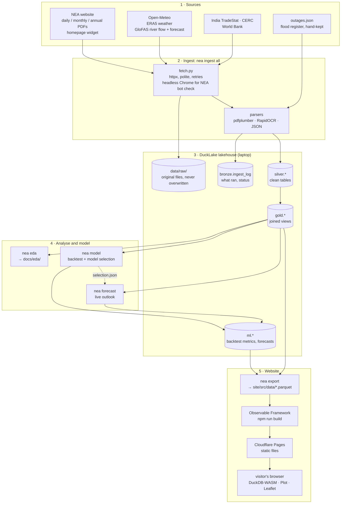
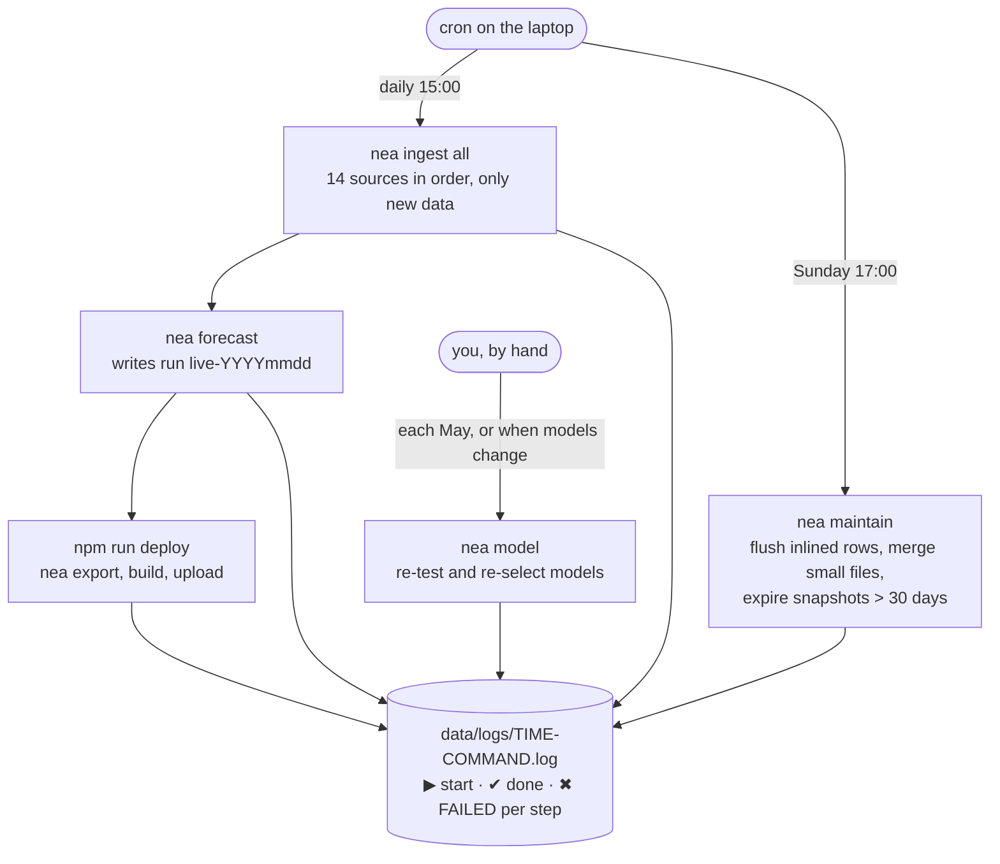
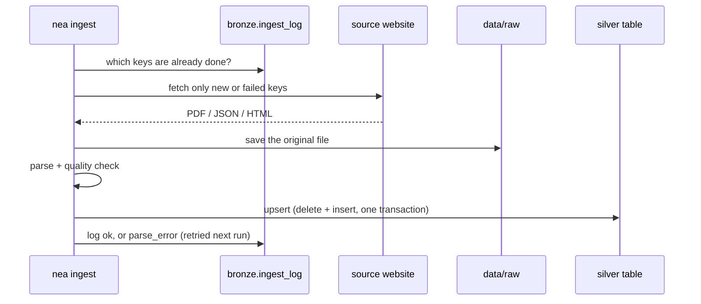
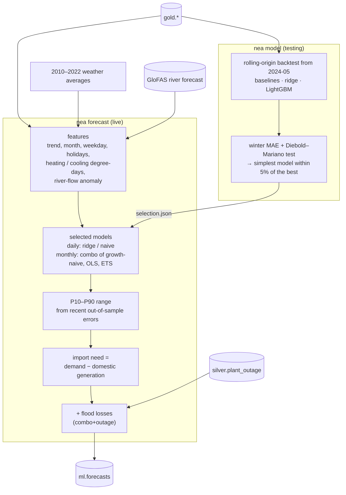

# How it works

How the data gets from the internet to a forecast and onto this page. Everything heavy runs on one laptop in Nepal. This site is static files: your browser downloads a small Parquet snapshot and runs SQL on it, so every chart is a query you can repeat in the [SQL explorer](./sql).

## 1. The whole system

- **Laptop does everything heavy.** It sits in Nepal because some government sites block foreign IPs.
- **The website has no server.** The browser downloads the Parquet snapshot and runs SQL on it with DuckDB-WASM. Every chart is one of those queries.

## 2. What runs when

A failing step is logged and skipped; the other steps still run. The exact cron lines are in the repository's `docs/flow.md`.

## 3. One ingest step, in detail

`ok` is written only after the table write commits, so a crash mid-run is simply redone next time.

## 4. How a forecast is generated

Model details and why each was chosen: the [Models](./models) and [Method & limits](./method) pages, and `docs/models/` in the repository.
